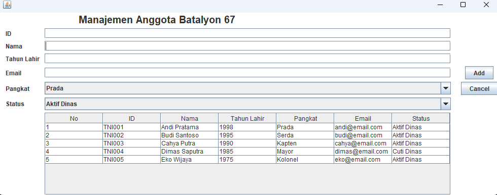
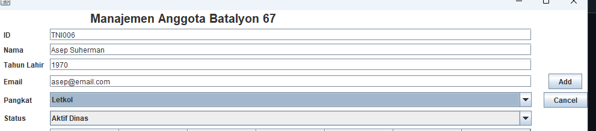
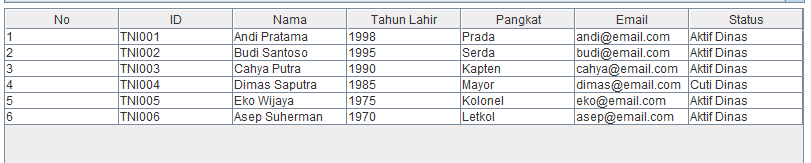
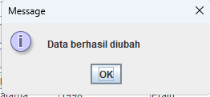
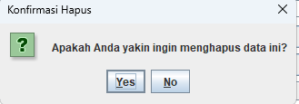
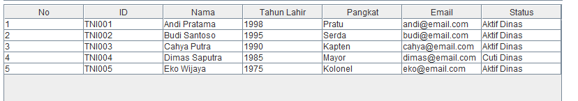

# TP4DPBO2526C2
## Janji

Saya Nabil Azka Saputra dengan NIM 2507096 mengerjakan TP2 dalam mata kuliah DPBO untuk keberkahanNya maka saya tidak melakukan kecurangan seperti yang telah dispesifikasikan. Aamiin

Desain dan Fungsi Program

### A. Atribut Data

Setiap anggota tentara memiliki atribut berikut:

| Atribut | Tipe Data | Keterangan |
|---|---|---|
| ID | String | Identitas unik anggota |
| Nama | String | Nama anggota tentara |
| Tahun Lahir | Integer | Tahun kelahiran anggota |
| Pangkat | String | Pangkat anggota tentara |
| Email | String | Alamat email anggota |
| Status Dinas | String | Status keaktifan anggota, yaitu Aktif atau Cuti |

## 3. Penjelasan Alur Program

Saat aplikasi dijalankan, program membuat objek `PeopleMenu` dan menginisialisasi daftar anggota tentara menggunakan `ArrayList`. Data awal dimasukkan melalui method `populateList()`, kemudian ditampilkan pada tabel menggunakan method `setTable()`.

Pengguna dapat mengelola data melalui formulir yang tersedia. Ketika salah satu baris tabel dipilih, data anggota akan ditampilkan kembali pada formulir agar dapat diubah atau dihapus.

Alur pengelolaan data terdiri dari empat operasi utama:

1. **Create:** pengguna mengisi formulir dan menekan tombol Add untuk menambahkan anggota baru ke dalam daftar.
2. **Read:** seluruh data anggota ditampilkan pada tabel, termasuk ID, nama, tahun lahir, pangkat, email, dan status dinas.
3. **Update:** pengguna memilih salah satu baris tabel, mengubah data melalui formulir, kemudian menekan tombol Update.
4. **Delete:** pengguna memilih anggota yang ingin dihapus dan menekan tombol Delete. Program menampilkan dialog konfirmasi sebelum menghapus data.

Tombol Cancel digunakan untuk membersihkan formulir dan mengembalikan kondisi input ke keadaan awal.

## 4. Dokumentasi Program

Dokumentasi berikut menunjukkan pelaksanaan setiap operasi CRUD pada aplikasi PeopleData. Screenshot di bawah bagian ini harus diambil dari hasil program yang benar-benar dijalankan.

### A. Tampilan Awal Program

Menampilkan antarmuka utama aplikasi PeopleData beserta data anggota tentara yang telah dimuat ke dalam tabel.

**Screenshot:**

### B. Create — Menambahkan Data

Pengguna mengisi ID, nama, tahun lahir, pangkat, email, dan status dinas. Setelah tombol Add ditekan, data baru dimasukkan ke dalam daftar dan ditampilkan pada tabel.

**Screenshot:**

### C. Read — Menampilkan Data

Program menampilkan daftar anggota tentara dalam tabel. Data yang ditampilkan mencakup seluruh atribut yang dimiliki setiap anggota.

**Screenshot:**

### D. Update — Mengubah Data

Pengguna memilih anggota dari tabel. Data anggota tersebut dimuat ke formulir, kemudian pengguna mengubah atribut yang diperlukan dan menekan tombol Update. Tabel diperbarui sesuai perubahan data.

**Screenshot:**

### E. Delete — Menghapus Data

Pengguna memilih anggota yang ingin dihapus, kemudian menekan tombol Delete. Program menampilkan dialog konfirmasi. Apabila pengguna menyetujui penghapusan, data dihapus dari daftar dan tabel diperbarui.

**Screenshot 1 — Dialog konfirmasi penghapusan:**

**Screenshot 2 — Data setelah penghapusan:**

